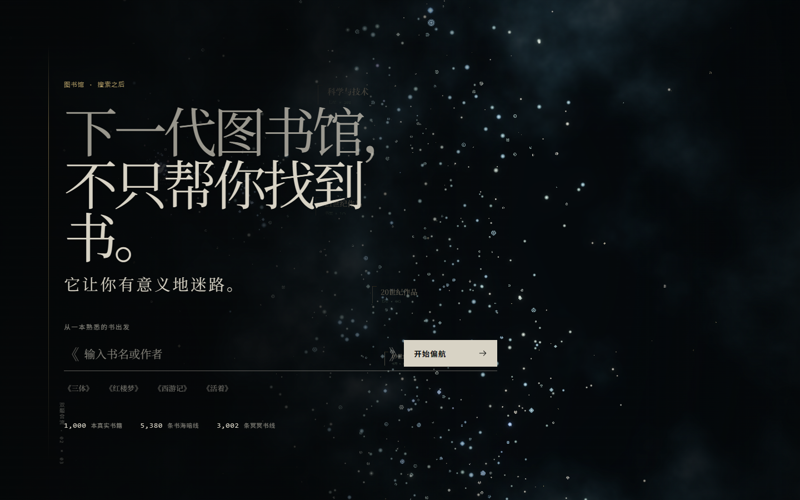
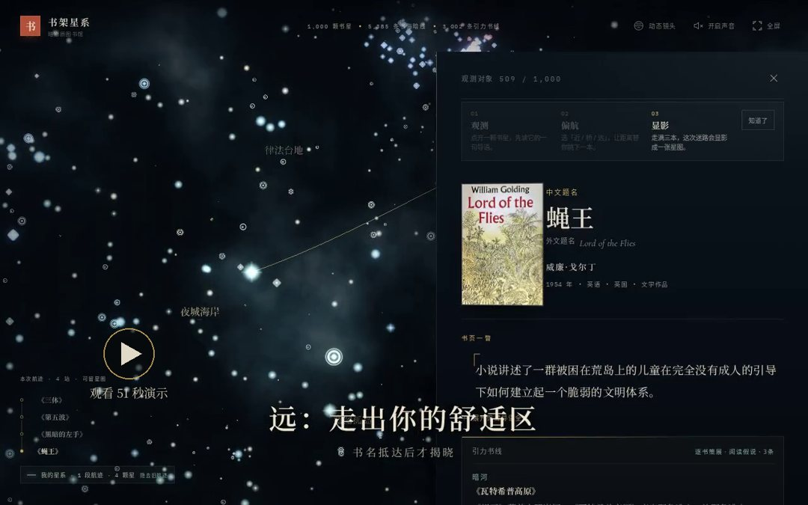
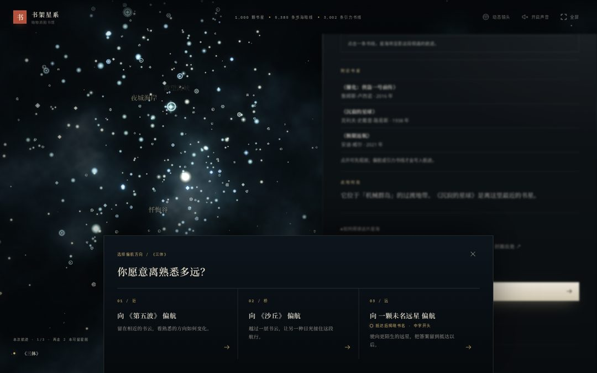
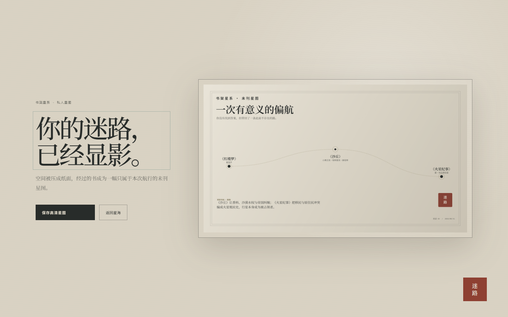

<h1 align="center">书架星系</h1>

<p align="center"><strong>从一本熟悉的书出发，在一千部真实作品之间，有意义地迷路。</strong></p>

<p align="center">
  <a href="https://vincejan.github.io/Book-Galaxy/">进入星海</a>
  &nbsp;·&nbsp;
  <a href="docs/architecture.md">技术手册</a>
  &nbsp;·&nbsp;
  <a href="data-sources.md">数据与来源</a>
</p>

[](https://vincejan.github.io/Book-Galaxy/)

## 30 秒速览

> **一句话**：一千部真实作品排成三维星海，从熟悉的书出发，用“近 / 桥 / 远”三档偏航，走出一张只属于你的阅读星图。

[](docs/demo.mp4)

| 黄金路线（动图节选） | 偏航罗盘 | 三站之后的星图 |
|---|---|---|
|  |  |  |

| 命题要求 | 星海里的对应 |
|---|---|
| 数字图书馆可漫游 | 1,000 颗真实书星的三维星海，12 片星域各有名字 |
| 意外发现而非推荐 | 近 / 桥 / 远三档偏航；远行只揭晓首字，抵达才见书名 |
| 书与书的关联可解释 | 3,002 条引力书线，馆员只引用馆藏导语原句，不编造 |
| 留下个人轨迹 | 三站显影未刊星图，“我的星系”跨次保留航迹 |
| 无服务器也完整 | 离线馆员、本地存储；首屏字体约 139 KB |

**30 秒试一试**：打开 [在线星海](https://vincejan.github.io/Book-Galaxy/) → 输入「三体」→ 开始偏航 → 点「从这里偏航」选一档 → 连走三站，看航迹显影成星图。

## 阅读不是一条直线

搜索擅长把人送到已经知道的地方。阅读有时需要相反的东西：不立刻得到答案，而是在一本书的余光里，看见另一颗尚未命名的星。

书架星系是一座可以漫游的三维数字图书馆。这里没有推荐流，也不替你排列必读清单。每颗星都是一部真实作品；你选择一本书作为出发点，让距离、主题与意外共同决定下一段航程。

## 一次偏航

1. **选择出发星** — 从一本熟悉的书进入星海，阅读它的书页一瞥。
2. **把航向交给远方** — 沿附近、过桥或远行继续，也可以让一条引力书线带你抵达原本不会寻找的作品。
3. **留下这次迷路** — 三本书以后，航迹会显影成一张属于本次阅读的未刊星图。

星海不会催促你完成任务。你可以停在一本书前，也可以召唤馆员追问一段缘分；没有追问时，馆员保持沉默。

## 远处的书，为什么会相遇

“附近书星”来自书目内容与相对位置；“引力书线”则提出更大胆、也更克制的问题：两部并不相邻的作品，是否会在人物命运、叙事方式或共同经验上彼此照见？

每条引力书线都明确标为**阅读假说**。它提供一种值得继续阅读的方向，但不冒充作者影响、引用关系或文学史结论。


## 这片星海

<p align="center">
  <strong>1,000</strong> 本真实书籍
  &nbsp;·&nbsp;
  <strong>5,385</strong> 条可漫游书海暗线
  &nbsp;·&nbsp;
  <strong>3,002</strong> 条引力书线
</p>

书目来自 Wikidata 与中文维基百科的可核查记录，封面为 902 张自托管的缩略图（Open Library、Wikimedia Commons 与维基百科），其余以生成藏书票代替。布局在离线完成；浏览器只载入已检查、固定版本的数据快照。每本书都保留来源与修订回链。

## 在本地打开

推荐使用 Node.js 24。

```bash
git clone https://github.com/VinceJan/Book-Galaxy.git
cd Book-Galaxy
npm ci && npm run dev
```

打开 `http://localhost:5173`。完整说明见 [技术手册](docs/architecture.md)。

## 进一步阅读

- [技术手册](docs/architecture.md)
- [星海地名](docs/region-naming.md)
- [数据与来源](data-sources.md)
- [数据归属与许可](DATA_LICENSE.md)
- [封面来源与许可](public/covers/ATTRIBUTION.md)：封面版权归出版方或原作者，仅用于非商业的作品展示与书籍识别；权利人如需撤下，请提 issue，我们会尽快移除。
- [MIT License](LICENSE)
